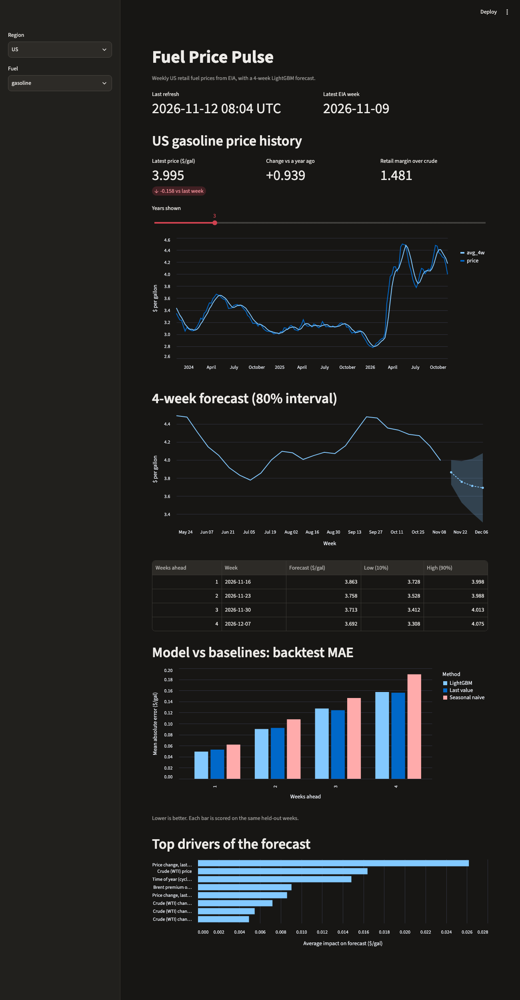
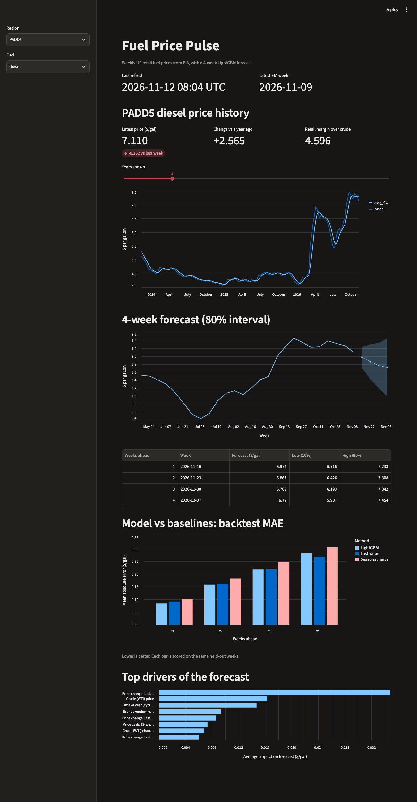
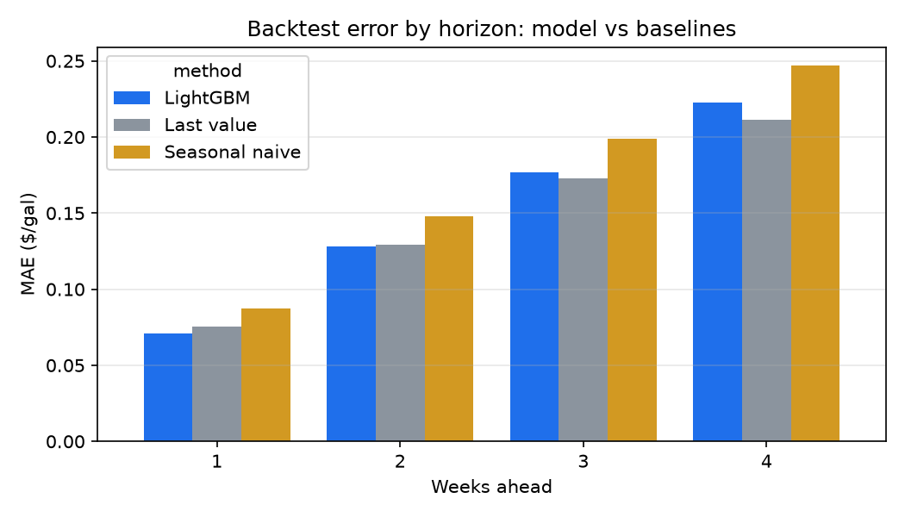
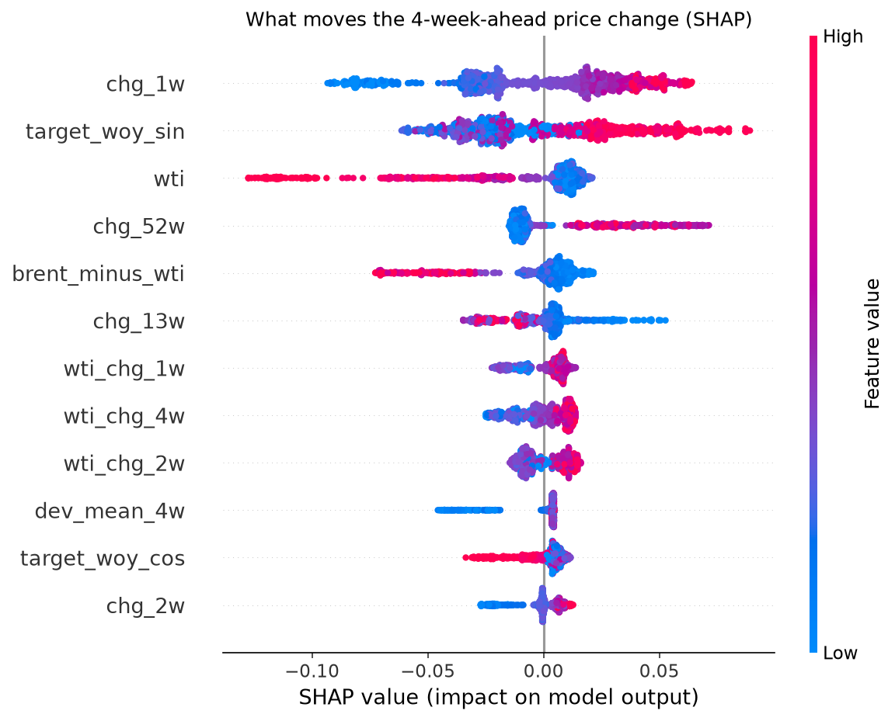
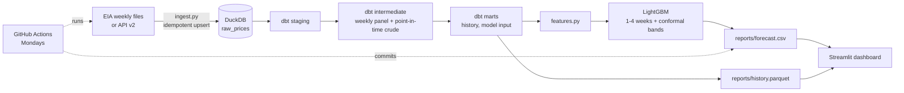

# Fuel Price Pulse

A weekly pipeline that forecasts U.S. retail gasoline and diesel prices four weeks ahead from public EIA data, tests the forecast against honest baselines, and refreshes a dashboard every Monday on its own.

[](https://github.com/abhiramvedipala/fuel-price-pulse/actions/workflows/ci.yml)

## Problem
I work at a gas station, and the question that comes up every week is where prices are heading over the next month. The government publishes the data, but nobody hands a station owner a forecast with an honest error bar and a plain statement of when to ignore it. This project does that for the U.S. average and the five PADD regions (Florida sits in PADD 1), for regular gasoline and diesel. The one-page owner's summary is [docs/findings.md](docs/findings.md).

## Demo




Backtest error by horizon, and what moves the 4-week forecast:




## Architecture

Every Monday the workflow loads the latest EIA weeks into DuckDB, builds three dbt layers and fails the run if any test fails, then refits the model on everything published so far and writes a four-week forecast with 80% intervals. The refreshed CSV, a parquet copy of the history and a run log are committed back to the repo, which is all the dashboard needs to run on a host with no warehouse.

## Tech stack
| Tool | Used for | Why I chose it |
|---|---|---|
| Python 3.12, uv | Language, environments, lockfile | One lockfile makes CI and a fresh clone identical |
| EIA weekly files / API v2 | Source data | Public and free; the no-key files keep the weekly job free of secrets |
| DuckDB | Warehouse (one file) | No server, runs in CI, fast for a few thousand rows |
| dbt (dbt-duckdb) | Cleaning, alignment, tests | Three layers with schema, freshness and range tests that fail loudly |
| LightGBM | Forecaster | Handles categoricals and interactions on ~6k rows with little tuning |
| SHAP | Explaining drivers | Exact for trees and additive in dollars per gallon |
| Streamlit | Dashboard | Python-only, deploys free from the repo |
| GitHub Actions | CI and the Monday refresh | Free, lives next to the code |
| pytest, ruff | Tests and lint | Standard and fast |

## Quick start
Prerequisites: [uv](https://docs.astral.sh/uv/) and Python 3.12. No API key is needed.

```bash
uv sync
scripts/check.sh            # lint, tests, ingest, dbt build, forecast and backtest smoke runs
uv run streamlit run app/streamlit_app.py
```
`scripts/check.sh --fixture` runs the same checks offline on a frozen two-year sample, which is what CI uses. Set `EIA_API_KEY` in `.env` to use the API instead of the public files.

## Results
Every number comes from a script in this repo; the full file is [RESULTS.md](RESULTS.md).

| Measure | Value | Command |
|---|---|---|
| Series ingested | 14 (12 retail, 2 crude), 8,664 rows, 2015-01-02 to 2026-11-09 | `uv run python -m fuelpulse.ingest` |
| dbt data tests | 40, all passing | `uv run dbt build --project-dir dbt --profiles-dir dbt` |
| Backtest window | 104 weekly origins, 2024-10-21 to 2026-10-12, 12 series, 4,992 forecasts | `uv run python -m fuelpulse.backtest` |
| MAE, 1 / 2 / 3 / 4 weeks ($/gal) | LightGBM 0.071 / 0.128 / 0.177 / 0.223 | `uv run python -m fuelpulse.backtest` |
| MAE, last-value baseline | 0.076 / 0.129 / 0.173 / 0.211 | `uv run python -m fuelpulse.backtest` |
| MAE, seasonal-naive baseline | 0.087 / 0.148 / 0.199 / 0.247 | `uv run python -m fuelpulse.backtest` |
| MAE, all horizons combined | LightGBM 0.1496, last value 0.1473, seasonal naive 0.1702 | `uv run python -m fuelpulse.backtest` |
| 80% interval coverage | 79.9 / 78.4 / 79.0 / 79.2 percent (79.1% overall); before the interval change 71 / 68 / 67 / 67 (68.5%) | `uv run python -m fuelpulse.backtest` |
| Top SHAP drivers | last week's change (0.032), WTI level (0.016), seasonal term (0.015) | `uv run python -m fuelpulse.explain` |

The model beats seasonal naive at every horizon and last value at 1 and 2 weeks, but loses to last value at 3 and 4 weeks (by 2% and 5%). **Across all horizons combined it is slightly worse than just repeating the last price** (MAE 0.1496 against 0.1473, about 1.5% higher). The gain is concentrated at one and two weeks. The intervals now cover 79.1% against an 80% target; the first version covered 68.5% and is kept in RESULTS.md as the "before" record. Wider bands are the price: the mean half-width is 0.12 to 0.34 $/gal, against 0.08 to 0.22 before.

## How it works
**Point-in-time crude join.** EIA dates crude weeks on Friday and retail weeks on Monday. A dbt ASOF join gives each Monday the newest crude week that had already ended, so no feature sees a future price.

**Predicting changes.** Each horizon has its own LightGBM model predicting the price change from the origin week, which I add back to the origin price. Trees cannot extrapolate beyond the levels they saw, so tying a forecast to a price level is fragile when the level shifts. Predicting the change avoids that. In practice 2026 stayed inside the training range (U.S. gasoline peaked at $4.50 in 2026 against a 2015-2024 training range of $1.72 to $5.01, which includes the 2022 spike), so I did not need it to avoid a cap; a validation test of level-free features changed MAE by about 0.1%.

**Rolling-origin backtest.** For each of 104 weekly origins the model trains only on rows whose targets were already published, forecasts 1-4 weeks ahead and is scored once the truth arrives, refit every 4 weeks. Model choice (pooled vs per-series) and hyperparameters were picked on the 52 origins before that window.

**Conformal intervals.** Errors on the last 104 weeks, from a model that never saw them, are divided by each series' trailing 13-week volatility. The 80th percentile of those scaled errors, times the volatility at the forecast origin, is the half-width, so bands widen when prices are moving. I picked this on the validation year after comparing six width schemes (`reports/model_experiments.md`).

**Idempotent ingest.** Rows upsert by (series, week) and update only when the value changed, so a second run writes zero rows. The last 4 weeks are re-read each run to pick up EIA revisions.

## Testing
```bash
uv run pytest -q          # 22 tests
uv run dbt build --project-dir dbt --profiles-dir dbt   # 40 data tests plus a seed and 5 models
```
pytest covers idempotent upserts and revisions, the `--since` watermark, leakage (features unchanged when later weeks are removed or inflated, all four horizons), the training cut-off, baseline definitions, interval symmetry, hand-checked MAE/RMSE/MAPE, holiday dates, and dashboard smoke runs. dbt tests cover uniqueness, not-null, accepted values, a $1-$10 per gallon range, contiguous weeks, crude never from the future, and data age.

## Design decisions and trade-offs
All 19 are in [DECISIONS.md](DECISIONS.md). The top three:
1. **Change targets, not levels.** Avoids the tree-extrapolation cap; costs a little interpretability.
2. **Report the loss.** The model is worse than "no change" at 3-4 weeks. I did not tune on the test window to hide it; the findings page tells owners to treat those weeks as a rough guide.
3. **Conformal intervals over quantile models.** Simpler and cheaper. Plain pooled bands under-covered (68.5% vs 80%) through the March 2026 shock; scaling by trailing volatility fixed most of that (79.1%) at the cost of wider bands on average.

## Known limits and next steps
- Weekly regional averages only; not a forecast for a specific street.
- One large shock (March 2026) dominates the worst misses; behaviour in other kinds of shock is untested.
- Bands are wider on average than before and still depend on volatility measured before a shock begins, so the first week of a sudden jump is under-covered. Next: adaptive conformal updates.
- No wholesale (RBOB) prices, which lead retail by days. Adding them is the most likely accuracy gain.
- Needs me: the GitHub repository and Streamlit Cloud deploy (steps below).

### Deploying the dashboard on Streamlit Community Cloud
1. Push this repo to GitHub (public, or private with the Streamlit GitHub app granted access).
2. At [share.streamlit.io](https://share.streamlit.io) choose **New app**, pick the repo, branch `main`, main file `app/streamlit_app.py`.
3. Under **Advanced settings** choose Python 3.12. Streamlit Cloud installs from `pyproject.toml`.
4. Deploy. The app reads `reports/*.csv` and `reports/history.parquet`, which the weekly workflow keeps fresh, so no secrets or warehouse are needed.

## Project structure
```
fuelpulse/      ingest, features, model, backtest, explain, forecast, results
dbt/            staging -> intermediate -> marts, seeds, tests
app/            Streamlit dashboard
tests/          pytest suite
scripts/        check.sh
reports/        forecast, backtest, SHAP outputs, run log
docs/           findings, interview notes, screenshots, PR descriptions
.github/        CI and weekly workflows
data/fixtures/  frozen two-year sample for offline CI
```
